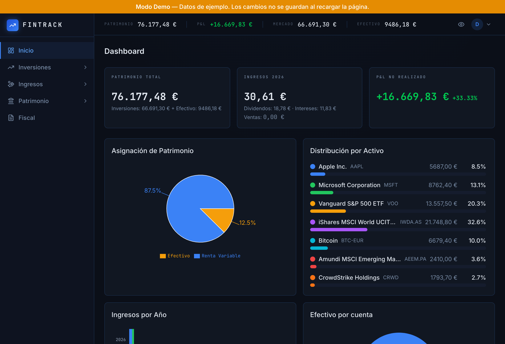
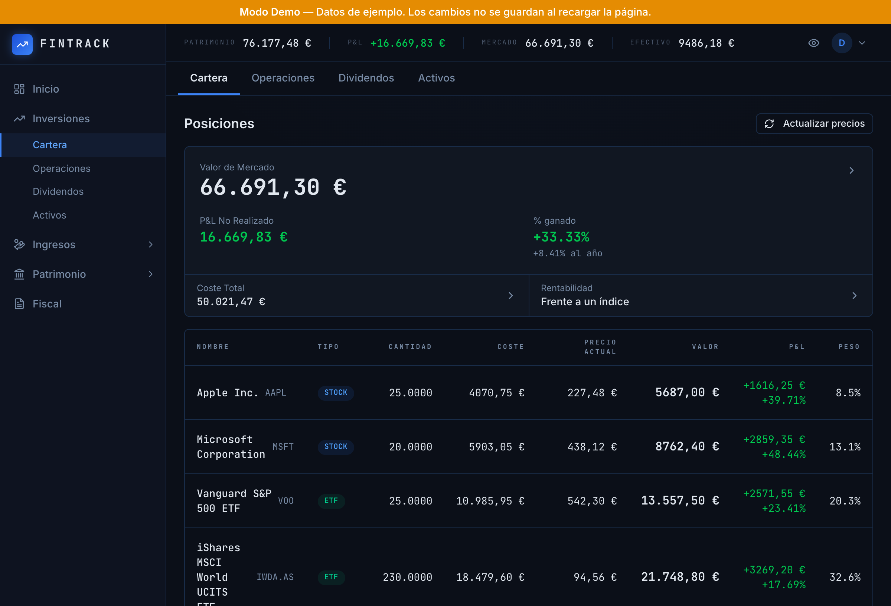
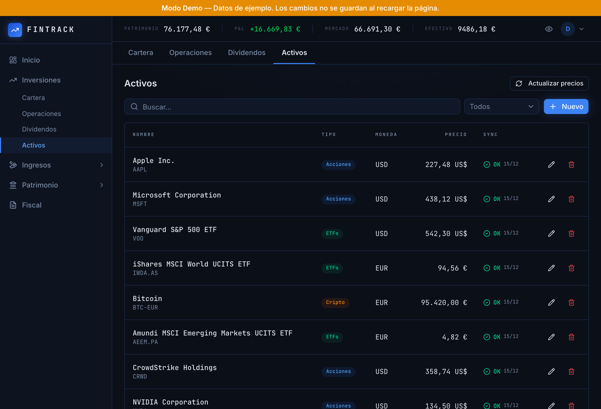
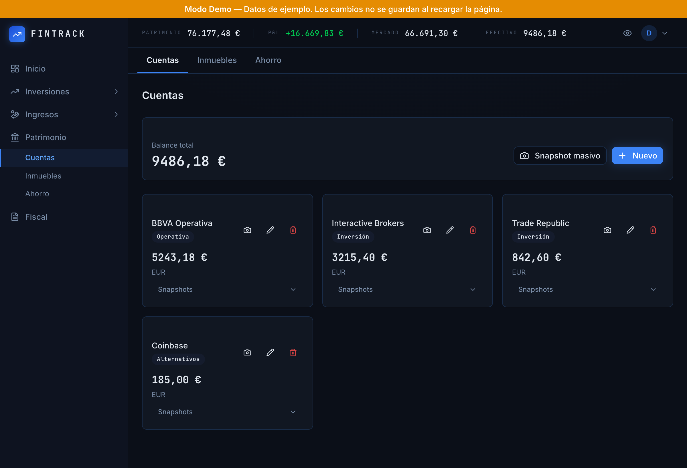
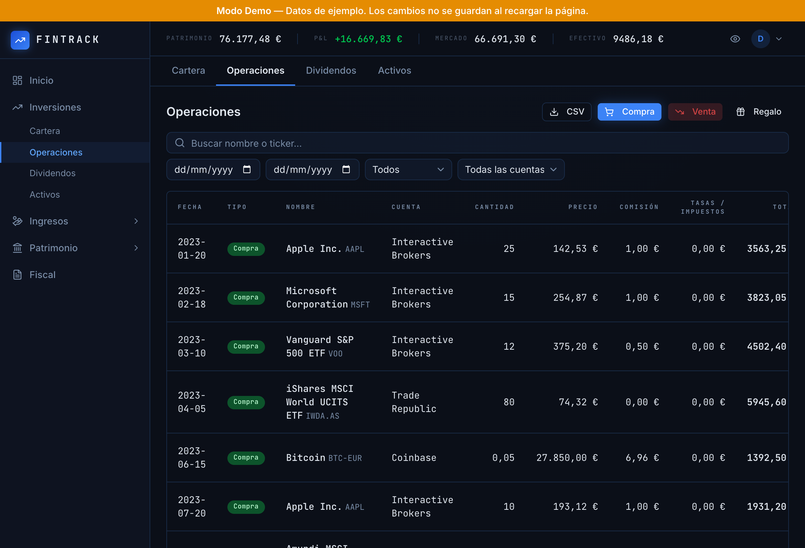
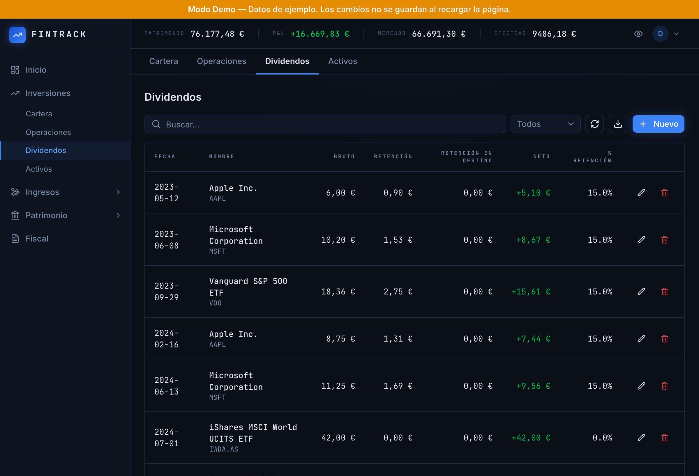
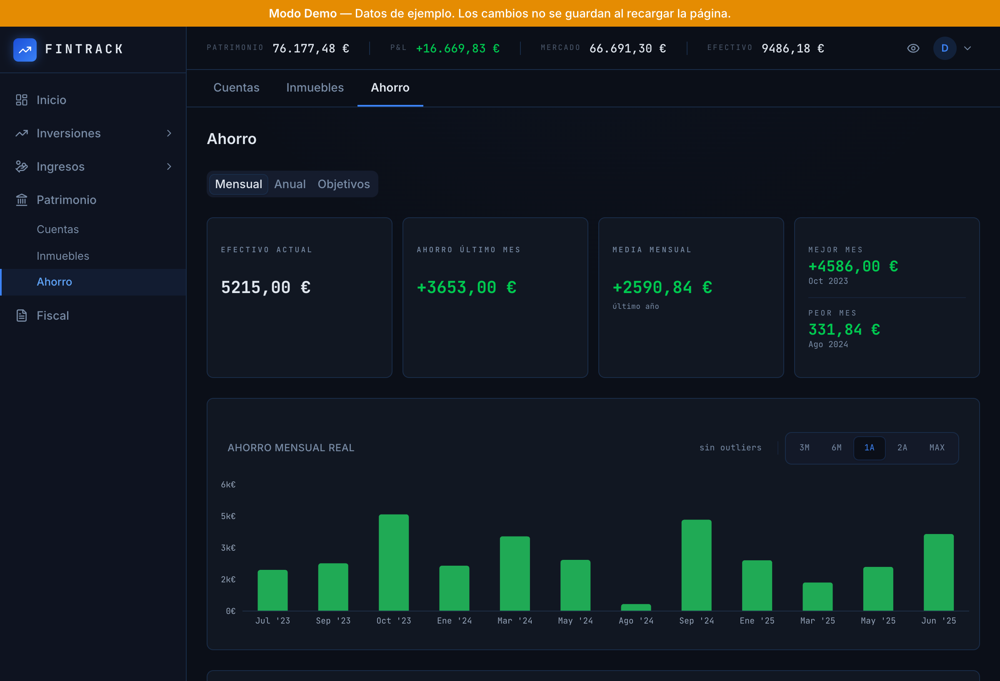
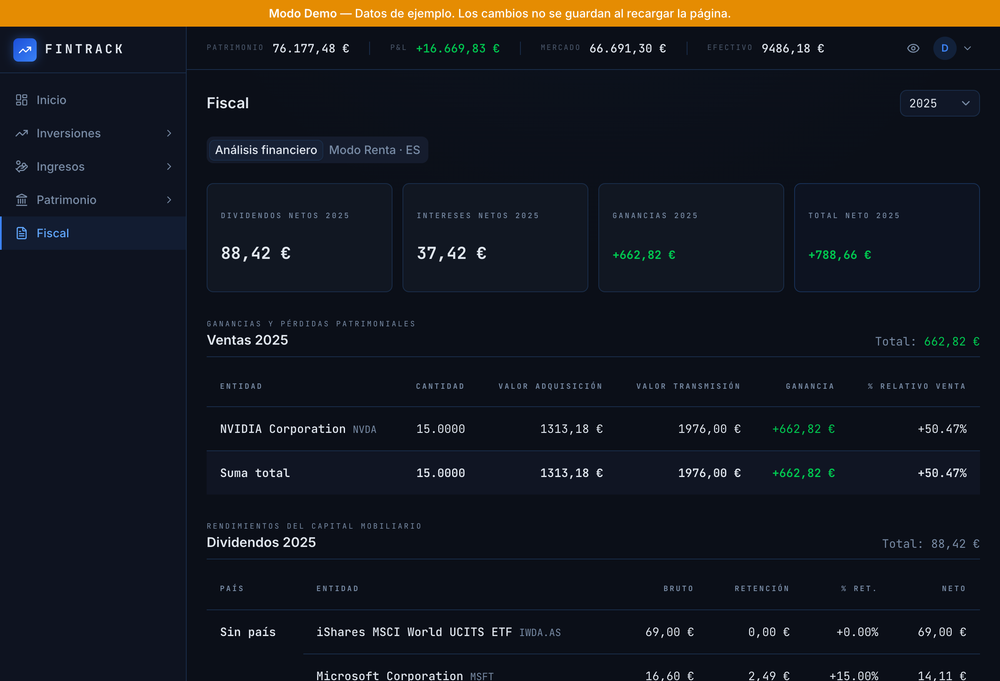
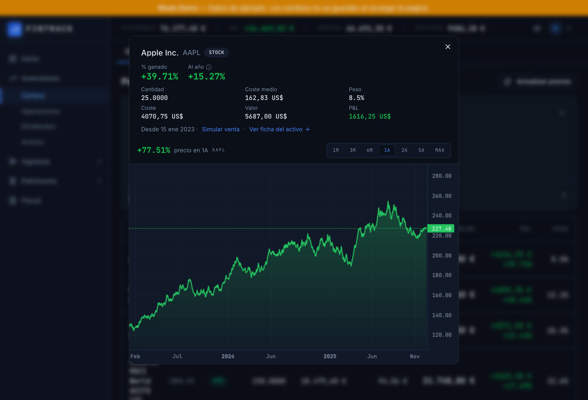
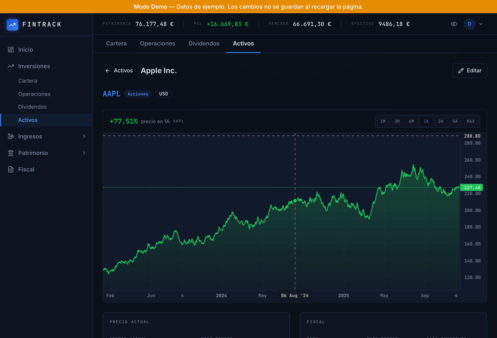

<div align="center">

# Fintrack

**Self-hosted investment portfolio tracker — built for privacy and clarity.**

Track your portfolio, transactions, dividends, interests and taxes from a single interface. No subscriptions, no data sharing, fully open source.

[](LICENSE)
[](https://github.com/Gonzalez8/fintrack/actions/workflows/ci.yml)
[](https://www.djangoproject.com/)
[](https://nextjs.org/)
[](https://react.dev/)
[](https://www.typescriptlang.org/)
[](https://www.docker.com/)
[](docs/CONTRIBUTING.md)

</div>

---

## Screenshots

<p align="center">
  
  
</p>
<p align="center">
  
  
</p>
<p align="center">
  
  
</p>
<p align="center">
  
  
</p>
<p align="center">
  
  
</p>

---

## Features

### Portfolio Management
- **Multi-asset support** — Stocks, ETFs, Funds, Crypto
- **Real-time pricing** — Automatic updates via Yahoo Finance
- **Cost basis engines** — FIFO, LIFO, and Weighted Average Cost (WAC)
- **Position tracking** — Unrealized P&L, cost basis, market value per position
- **Stock splits** — Splits and reverse splits per asset, auto-detected daily from Yahoo Finance and applied after your review. The cost engine scales the lots held at the split date (more shares, same total cost); trades before and after the split keep their own figures ([ADR-009](docs/adr/009-stock-splits-and-dividend-drafts.md))
- **Position history** — Per-asset timeline of operations and splits with the shares held after each step, so the current quantity can be reconciled with your broker. Split badges in the portfolio and split rows in the operations list ("28 → 112 today")

### Transaction Tracking
- **Buy / Sell / Gift** transactions with commission and tax support
- **Dividend tracking** — Gross, withholding tax, administration / custody fees, net and withholding rate per asset
- **Dividend drafts** — Dividends detected on Yahoo Finance become pre-filled drafts (shares held on the ex-date, estimated gross and withholding). Review each one against your broker and accept it; drafts never count in reports or tax until accepted, and existing dividends are never duplicated
- **Type-to-search pickers** — Pick the asset of a trade or dividend by typing part of its name or ticker
- **Interest income** — Date-range based tracking per account, with optional explicit withholding tax (NULL = inferred from gross/net, 0 = confirmed no withholding) and fees
- **Other income** — Rent, self-employment, side jobs, gifts or anything outside payslips, dividends and interests, one record per payment with an optional account. "Repeat last" fills in a new month in two fields. Counts for savings and estimated spending; not for the tax views (rent recorded against a lease feeds the rental tax instead). See [ADR-011](docs/adr/011-other-income-and-estimated-spending.md)
- **Import deduplication** — Hash-based duplicate detection

### Accounts & Snapshots
- **Multiple account types** — Operativa, Ahorro, Inversion, Depositos, Alternativos
- **Balance snapshots** — Historical balance tracking with auto-sync
- **Portfolio snapshots** — Periodic automated snapshots via Celery Beat
- **Bulk snapshot** — Update all account balances in one action

### Reports & Analytics
- **Year summary** — Dividends, interests, realized P&L, total income by year
- **Patrimonio evolution** — Total net worth over time (cash + investments)
- **Portfolio evolution** — Market value, cost basis, unrealized P&L charts
- **Monthly savings** — Cashflow and savings rate analysis, with the month's income (net payslips, other income, dividends and interests) and the **estimated spending** it implies (income − real savings)
- **Annual savings** — Yearly savings aggregates and breakdown, with yearly income and estimated spending
- **Savings goals** — Target-based goals with 3-scenario projections (conservative, average, optimistic)
- **CSV exports** — Transactions, dividends, and interests

### Tax Reporting

Fintrack ships **two layers** of tax reporting:

#### Country-agnostic (always available)
- **Year summary** — Dividends, interests and realized P&L by year
- **Withholdings by country** — Foreign vs. local breakdown for any residency
- **CSV export** — Per-year transactions, dividends and interests

#### Country-specific tax-declaration assistant
- **Fiscal residence in Settings** — Pick your country (`Settings.tax_country`, ISO 3166-1 alpha-2). Default `ES`. The declaration tab only appears when an adapter exists for your country.
- **Spain (Modo Renta)** — Maps your data directly to the AEAT Renta Web boxes (Modelo 100):
  - Interests, dividends (Spanish vs. foreign split), foreign double-taxation deduction (per-country, with the bilateral treaty cap — default 15%, configurable via `Settings.tax_treaty_limits`), capital gains
  - Row-by-row declarable share sales with one-click "Copy row" (Entity / Transmission / Acquisition tab-separated)
  - Final summary card with "Copy all" payload for the whole return
  - Validation warnings — sales without cost basis, dividends without tax country, `gross ≠ net + withholding + fees` mismatches
- **Other countries** — Pluggable. Adding a country only touches its own adapter module. See [ADR-007: Per-Country Tax Adapter Pattern](docs/adr/007-tax-adapter-pattern.md) for the recipe and design rationale.

### Data Management
- **Snapshot scheduling** — Configurable auto-snapshot frequency (15min to 24h)
- **Data retention** — Automated purge of old snapshots (configurable: 1y, 5y, 10y, never)
- **Storage monitoring** — Per-user database space tracking
- **Bulk snapshots** — Update all account balances at once
- **JSON backup/restore** — Full data export and import: settings, assets, accounts and snapshots, operations, splits, dividends and drafts, interests, other income, employers and payslips, savings goals, properties and amortizations (API tokens are never exported)

### Payroll Tracking
- **Digitised payslips** — Track monthly net, gross, Social Security contributions and income tax withheld per employer. Feeds the Spanish Modo Renta tab as "Rendimientos del trabajo".
- **Best-effort PDF parser (experimental)** — Upload a Spanish payslip PDF and Fintrack extracts gross, SS, IRPF, net, base IRPF and employer info to pre-fill the form. Suggestion-only, you always review and confirm before saving. Falls back to manual entry on unrecognised templates or scanned PDFs.
- **Employer registry** — Reusable employer records (name, CIF, SS account) referenced by every payslip. Inline employer creation from the payroll dialog.
- **Soft conciliation** — A `gross − SS − IRPF − net` warning surfaces when the identity breaks (anticipos, embargos, dietas exentas, retribución en especie…), but never blocks saving — real payslips legitimately diverge from that identity.
- See [ADR-008](docs/adr/008-payroll-and-pdf-parser.md) for the full design.

### Security & Auth
- **JWT in httpOnly cookies** — Access + refresh tokens, SameSite=Lax
- **Google OAuth 2.0** — One-click login with automatic account creation
- **Rate limiting** — Per-endpoint throttling (login, register, password change)
- **Multi-tenancy** — Strict owner-based data isolation
- **Personal API tokens** — Read-only or read-write tokens for the MCP server and scripts: hashed at rest, revocable, and unable to delete data, manage tokens or touch the account

### Real Estate & Mortgage
- **Property tracking** — Current value, purchase price, net equity per property
- **Smart mortgage setup** — Enter loan amount, term (years), rate type (fixed/variable) and rate. Monthly payment, months paid, and outstanding balance auto-calculated from purchase date
- **Interactive amortization table** — Click any row (past or future) to add an early amortization. Choose reduce payment or reduce term per event. Schedule recalculates instantly
- **Multiple amortizations** — Add several events at different months, each cascading into the next
- **Timeline chart** — Balance curve (original vs modified), event markers, current position
- **Payment breakdown** — Principal vs interest stacked bars per month
- **Mortgage summary** — Side-by-side comparison: original vs modified for payment, installments, term, end date, total to pay, total interest, with savings highlighted
- **Amortization persistence** — Events stored in database, optimistic UI updates

### Rental management (Spain)
- **Leases, payments and expenses** — Per property: tenant, dates, monthly rent, deposit and the main-home reduction regime (60 % before 26/05/2023, 50 % general, 70/90 % in stressed areas…); rent payments are other income linked to the lease (so they count for savings); expenses by type (IBI, community, insurance, repairs, interest, utilities, agency, improvements)
- **Tax result to date and projected** — Net rent for the tax return with the Spanish rules: interest + repairs capped at the income (excess carried forward 4 years), year-round costs prorated by days rented, 3 % building depreciation on the higher of cost and cadastral value (without land) plus improvements, 10 % furniture, reduction, empty-days imputation; mortgage interest of the calendar year from the property's mortgage; estimated extra income tax on top of your payslips and what is left in cash
- **Simulator** — Every figure editable, recomputed by the server with the difference against the projection
- **Modo Renta** — "Rendimientos del capital inmobiliario" block with copyable figures per property. See [ADR-012](docs/adr/012-rental-management-and-tax.md)

### Privacy Mode
- **One-click toggle** — Eye icon in sidebar / mobile nav masks all personal monetary amounts
- **Smart masking** — Only personal amounts hidden (balances, gains, dividends). Public data stays visible: asset prices, percentages, share quantities
- **Persistent** — Stored in cookie, survives page reload

### AI Assistant (MCP)
- **Use Fintrack from Claude** — A local MCP server lets Claude Desktop or Claude Code review your portfolio, operations, dividends and reports, find inconsistencies and, with a write-enabled token, add records. See [AI Access (MCP)](#ai-access-mcp)

### Internationalization
- **5 languages** — Spanish, English, German, French, Italian

---

## Quick Start

### Option 1: Docker Compose (development)

```bash
git clone https://github.com/Gonzalez8/Fintrack.git && cd Fintrack
cp .env.example .env
docker compose up
```

| Service | URL |
|---|---|
| App | `http://localhost:3000` |
| API | `http://localhost:8000/api/` |
| Swagger UI | `http://localhost:8000/api/schema/swagger-ui/` |
| Django Admin | `http://localhost:8000/admin/` |

Create a superuser (optional):

```bash
docker compose exec backend python manage.py createsuperuser
```

### Option 2: Production (Pre-built Images)

No source code needed — uses images from GitHub Container Registry.

```bash
mkdir fintrack && cd fintrack
curl -O https://raw.githubusercontent.com/Gonzalez8/Fintrack/main/docker-compose.prod.yml
curl -O https://raw.githubusercontent.com/Gonzalez8/Fintrack/main/.env.production.example
cp .env.production.example .env
# Edit .env with your values (DB_PASSWORD, DJANGO_SECRET_KEY, etc.)
docker compose -f docker-compose.prod.yml up -d
```

The superuser is created automatically on first start (`admin` / `admin` by default — change in `.env`).

> Always set strong, unique values for `DB_PASSWORD`, `DJANGO_SECRET_KEY` and `DJANGO_SUPERUSER_PASSWORD` before deploying.

### Option 3: Portainer

1. In Portainer, go to **Stacks > Add stack**
2. Paste the contents of [`docker-compose.prod.yml`](docker-compose.prod.yml)
3. Add the required [environment variables](#environment-variables)
4. Click **Deploy the stack**

### Option 4: Live Demo (Vercel, with or without backend)

Enabling the demo flag adds a "Try Demo" button on the login page. Clicking it starts a [MSW (Mock Service Worker)](https://mswjs.io/) session with static data — no database needed. Real login and registration still work normally if a backend is configured.

| Vercel Setting | Value |
|---|---|
| Root Directory | `frontend` |
| Build Command | `npm run build` |
| Environment Variable | `NEXT_PUBLIC_DEMO_MODE=true` |

**Test demo locally:**

```bash
cd frontend && NEXT_PUBLIC_DEMO_MODE=true npm run dev
```

> `NEXT_PUBLIC_DEMO_MODE=true` enables the demo button — it does **not** replace real auth. Demo sessions are identified by a `demo: true` flag in the JWT token, so they coexist with real users on the same deployment.

---

## Architecture

```
┌─────────────────────────────────────────────────────────────┐
│                        Browser                              │
└──────────────────────────┬──────────────────────────────────┘
                           │
              ┌────────────▼────────────┐
              │      Nginx (port 80)    │  Reverse proxy
              └──┬──────────────────┬───┘
                 │                  │
          /api/* │ /admin/* /static/*  │ /*
          ┌──────▼──────┐    ┌──────▼──────┐
          │  Django 5.1 │    │  Next.js 16 │
          │  Gunicorn   │    │  SSR + BFF  │
          │  Port 8000  │    │  Port 3000  │
          └──┬─────┬───┘    └─────────────┘
             │     │
    ┌────────▼┐  ┌─▼────────┐
    │ Postgres │  │  Redis   │
    │   :5432  │  │  :6379   │
    └──────────┘  └─┬────┬───┘
                    │    │
          ┌─────────▼┐ ┌─▼──────────┐
          │  Celery  │ │ Celery Beat │
          │  Worker  │ │  Scheduler  │
          └──────────┘ └─────────────┘
```

### BFF Pattern

The browser **never** calls the Django API directly. All requests flow through Next.js Route Handlers (`/api/proxy/*`), which:
1. Read JWT from httpOnly cookies
2. Forward the request to Django with the Authorization header
3. Handle token refresh transparently
4. Return the response to the browser

### Rendering Strategy

| Route Group    | Strategy           | Description                        |
| -------------- | ------------------ | ---------------------------------- |
| `(marketing)/` | SSG                | Landing page, static generation    |
| `(auth)/`      | Client Components  | Login, Register forms              |
| `(dashboard)/` | SSR + Streaming    | Server Components + React Suspense |

---

## Security & Authentication

### JWT token flow

```
Browser
  ├── Cookie ──► access token  (httpOnly, SameSite=Lax)
  └── Cookie ──► refresh token (httpOnly, SameSite=Lax)
        │
        └─► POST /api/auth/token/refresh/  ──►  new access token
```

- Refresh token rotates on every use and is blacklisted after rotation (replay-safe).
- All requests attach Bearer token automatically; 401 triggers a single transparent retry.

### Google OAuth2

```
1. Load Google GIS script on login page
2. User clicks "Continue with Google"
3. Google returns an ID token (credential)
4. POST /api/auth/google/ { credential }
5. Backend verifies token with Google's public keys
6. Get or create user by email
7. Issue JWT pair → login complete
```

**Setup:**
1. [Create an OAuth 2.0 Client ID](https://console.cloud.google.com/apis/credentials) (Web application)
2. Add your domain to **Authorized JavaScript origins**
3. Set `GOOGLE_CLIENT_ID=<your-id>` in `.env`

---

## AI Access (MCP)

Fintrack ships an [MCP](https://modelcontextprotocol.io) server (`mcp/`) so an AI assistant — **Claude Desktop** or **Claude Code** — can work with your data: review your portfolio and history, explain figures, spot missing operations, prepare your tax data and, if you allow it, record operations and dividends, add assets and update your account balances for you.

It runs **locally on your computer** and talks to your Fintrack over your own network. Fintrack does **not** need to be exposed to the internet.

```
Claude Desktop / Claude Code ──stdio──▶ fintrack-mcp (your computer) ──HTTP + token──▶ Fintrack backend (:8001)
```

### Setup

**1. Create a token** — In Fintrack go to **Settings → AI access (MCP)**, give it a name and choose its permissions:

| Permission | The assistant can… |
|---|---|
| **Read only** (recommended to start) | Read portfolio, operations, dividends, interests, other income, reports and pending reviews |
| **Read and write** | Also create operations, dividends, interests and other income, record rent payments and rental expenses, accept or dismiss dividend drafts, apply splits, add or edit assets and record account balances |

The token (`ft_…`) is shown **once**, together with the configuration for Claude Code and Claude Desktop already filled in — copy it from there.

**2. Let your computer reach the backend** — The MCP calls the backend directly (port `8001` in `docker-compose.prod.yml`; `http://localhost:8000` in development). Add the address you use to `ALLOWED_HOSTS` in `.env` and restart:

```bash
ALLOWED_HOSTS=your-domain.com,192.168.1.10
docker compose -f docker-compose.prod.yml up -d
```

Then set that address once in **Settings → AI access (MCP) → Connection to your Fintrack**: *Test connection* checks it from your browser and *Save* stores it, so every command the page generates uses it (by default it suggests the web host on port `8001`).

*Behind a reverse proxy* (Nginx Proxy Manager, Traefik, Caddy…): the web host points to the frontend, so give the backend its own host, e.g. `fintrack-api.example.com` → backend port `8001`, add that name to `ALLOWED_HOSTS` and save `https://fintrack-api.example.com` as the backend URL in Settings. Use a **one-level** subdomain if your certificate is a wildcard — `*.example.com` covers `fintrack-api.example.com` but not `api.fintrack.example.com`.

**3. Install [uv](https://docs.astral.sh/uv/)** (it downloads and runs the MCP for you):

```bash
brew install uv            # macOS · see the uv docs for Linux/Windows
```

**4. Connect your assistant**

*Claude Code:*

```bash
claude mcp add fintrack \
  --env FINTRACK_URL=http://192.168.1.10:8001 \
  --env FINTRACK_TOKEN=ft_your_token \
  -- uvx --from "git+https://github.com/Gonzalez8/fintrack@vX.Y.Z#subdirectory=mcp" fintrack-mcp
```

*Claude Desktop* — add to `claude_desktop_config.json` (macOS: `~/Library/Application Support/Claude/`) and restart the app:

```json
{
  "mcpServers": {
    "fintrack": {
      "command": "/opt/homebrew/bin/uvx",
      "args": ["--from", "git+https://github.com/Gonzalez8/fintrack@vX.Y.Z#subdirectory=mcp", "fintrack-mcp"],
      "env": { "FINTRACK_URL": "http://192.168.1.10:8001", "FINTRACK_TOKEN": "ft_your_token" }
    }
  }
}
```

Claude Desktop doesn't inherit your terminal's `PATH`, so the config uses the **full path** to `uvx` (`/opt/homebrew/bin/uvx` for Homebrew on Apple Silicon; run `which uvx` if you installed it differently).

Replace `vX.Y.Z` with **your Fintrack version** (e.g. `v2.14.0`): the MCP is pinned to the same release as your backend so its tools always match your API. The Settings page fills in the exact version for you.

**5. Check it** — In Claude Code run `claude mcp list` (or `/mcp` inside a session): `fintrack` must show as connected. In Claude Desktop the Fintrack tools appear in the tools menu of a new chat. Then ask something simple such as *"What's my portfolio worth?"*.

**Updating** — You don't need to touch the MCP on every Fintrack update; do it when the release notes mention MCP changes. Copy the new command from Settings (Claude Code: `claude mcp remove fintrack` and add it again; Claude Desktop: change the version in the config and restart).

### What to ask

- *"Summarise my portfolio: total value, gain, and the five biggest positions."*
- *"How much bonus did I get in 2025 and what share of my fixed salary is it? What was my effective IRPF?"*
- *"How much have I saved per year, and how much do I invest each month on average?"*
- *"How much have I put into the S&P 500 in total?"*
- *"Review each of my investments for my profile and tell me what you'd keep, review or watch."* (asks for your profile first)
- *"Check whether any dividend's share count doesn't match my operations and tell me what could be missing."*
- *"Show me the position history of BYD and explain how I got to 65 shares."*
- *"How much did I receive in dividends in 2025, by country and with the withholding?"*
- *"Which dividends are pending review? Accept the Apple one: paid on 16/11/2026, gross 0.33 €, withholding 0.05 €."* (write token)
- *"I bought 5 Inditex shares today at 42.10 € on Trade Republic with 1 € commission — record it."* (write token)
- *"Add the Vanguard FTSE All-World ETF, ticker VWCE.DE, ISIN IE00BK5BQT80."* (write token)
- *"My balances on the 1st: Trade Republic 1,250 €, MyInvestor 8,400 € — update them."* (write token; saves a snapshot per account)
- *"Record this month's rent of the flat into MyInvestor."* / *"How much do I really spend per month?"* (estimated spending = income − savings)
- *"How much will the flat's rent add to my tax this year, and what is left after costs?"*

It can also cover payslips (salary, bonus, IRPF), monthly and yearly savings, money invested per month or per fund, account balances, savings goals and your mortgage. Ready-made prompts are included: **monthly review**, **payroll and bonus review** and **portfolio analysis**.

### Advisor skill (recommended)

The repository ships a **`fintrack-advisor`** skill that teaches the assistant *how* to answer: which tool fits each question, the definitions Fintrack uses, and a portfolio-review method (concentration, overlapping funds, costs, currency, emergency fund, savings rate, bonus dependence, Spanish tax, mortgage vs investing). Before any opinion or recommendation **it asks for your investor profile** (horizon, risk tolerance, goals, emergency fund, income stability, preferences) and doesn't store it.

Each release attaches it as `fintrack-advisor.zip`:

```bash
# Claude Code
curl -L -o /tmp/fintrack-advisor.zip https://github.com/Gonzalez8/fintrack/releases/download/vX.Y.Z/fintrack-advisor.zip
mkdir -p ~/.claude/skills && unzip -o /tmp/fintrack-advisor.zip -d ~/.claude/skills/
```

In Claude Desktop or claude.ai, upload the same ZIP in the *Skills* section of Settings.

The assistant uses Fintrack's own engine (FIFO/LIFO/WAC, splits, tax rules), so figures match the app. It's analysis of your own data, not regulated financial advice.

### Permissions and safety

- **Before every write** your AI client asks for confirmation; the assistant is instructed to show you exactly what it will record.
- **No token can delete** data, change your password or profile, create or revoke tokens, or restore backups — even a read-and-write one. Mistakes are fixed by you in the app.
- **Revoke** a token at any time in Settings → AI access; it stops working immediately. Tokens are stored hashed and show their last use.
- **Privacy:** whatever the assistant reads is sent to the AI provider to answer you. Prefer read-only tokens and revoke the ones you no longer use.

### Troubleshooting

| Message from the assistant | Fix |
|---|---|
| *Cannot connect to Fintrack at …* | Check `FINTRACK_URL` (backend port `8001`, not the web port) and that the server is reachable from your computer |
| *Fintrack refused the request for host …* | Add that host/IP to `ALLOWED_HOSTS` and restart the backend |
| *The Fintrack token was rejected* | The token was revoked or mistyped — create a new one in Settings |
| *This API token is read-only* | Create a read-and-write token if you want the assistant to add records |
| `uvx: command not found` | Install uv (step 3) and restart Claude |
| Claude Desktop: *spawn uvx ENOENT* / server fails to start | Use the full path from `which uvx` as `command` in `claude_desktop_config.json` |
| *SSL: no alternative certificate subject name matches* | The certificate doesn't cover that host — with a wildcard, use a one-level subdomain (see step 2) |

The full list of tools and how to develop the server are in [`mcp/README.md`](mcp/README.md); design rationale in [ADR-010](docs/adr/010-mcp-server-and-api-tokens.md).

## Tech Stack

| Layer | Technology |
|---|---|
| **Backend** | Django 5.1 · Django REST Framework 3.15 · PostgreSQL 16 · Celery 5.3 · Redis 7 |
| **Auth** | djangorestframework-simplejwt · google-auth |
| **Frontend** | Next.js 16 · React 19 · TypeScript 5 · Tailwind CSS v4 · shadcn/ui (Base UI) |
| **State** | TanStack Query 5 (server state) |
| **Charts** | Recharts 3 · Lightweight Charts 5 |
| **i18n** | Custom i18n (es, en, de, fr, it) |
| **Infra** | Docker Compose · GitHub Actions CI · GHCR |
| **API Docs** | drf-spectacular (OpenAPI 3 / Swagger UI) |

---

## Project Structure

```
fintrack/
├── backend/                       Django 5.1 + DRF
│   ├── apps/
│   │   ├── core/                  JWT auth, personal API tokens, base models, health check
│   │   ├── assets/                Assets, accounts, snapshots, settings
│   │   ├── transactions/          Transaction, Dividend, Interest, StockSplit, DividendSuggestion
│   │   ├── portfolio/             Cost basis engine (FIFO/LIFO/WAC)
│   │   ├── reports/               Tax summaries, evolution, savings, goals
│   │   ├── realestate/            Property, Amortization, mortgage simulation
│   │   ├── payroll/               Employer, Payroll, PDF payslip parser
│   │   └── importer/              JSON backup / restore
│   └── config/
│       ├── settings/              base.py · development.py · production.py
│       ├── urls.py
│       └── celery.py
│
├── frontend/                      Next.js 16 App Router
│   └── src/
│       ├── app/
│       │   ├── (marketing)/       Landing page (SSG)
│       │   ├── (auth)/            Login, Register (Client Components)
│       │   ├── (dashboard)/       Protected pages (SSR + Streaming)
│       │   └── api/               BFF Route Handlers (proxy to Django)
│       ├── components/
│       │   ├── ui/                shadcn/ui (Base UI + Tailwind v4)
│       │   └── app/               Domain-specific components
│       ├── lib/                   api-client, utils, mortgage-math, privacy
│       ├── types/                 TypeScript interfaces
│       ├── demo/                  MSW handlers (demo mode)
│       └── i18n/                  Translations (es, en, de, fr, it)
│
├── mcp/                           MCP server (Python, stdio) for AI assistants
│   ├── fintrack_mcp/              server.py (tools) · client.py (API client)
│   └── tests/
│
├── .github/workflows/
│   ├── ci.yml                     Backend, frontend and MCP lint + tests
│   └── docker-publish.yml         Build & push to GHCR
├── docker-compose.yml             Development (6 services)
├── docker-compose.prod.yml        Production (pre-built images from GHCR)
└── .env.example                   Environment variable template
```

---

## API

Interactive docs available at [`/api/schema/swagger-ui/`](http://localhost:8000/api/schema/swagger-ui/) when running locally.

```
# Auth
POST    /api/auth/token/                  Login → { access, user } + httpOnly cookie
POST    /api/auth/token/refresh/          Rotate refresh token → { access }
POST    /api/auth/logout/                 Blacklist token + clear cookie
GET     /api/auth/me/                     Current user
POST    /api/auth/register/               Create account (403 if disabled)
POST    /api/auth/google/                 Google ID-token login / register
GET     /api/auth/profile/                User profile
PUT     /api/auth/profile/                Update username / email
POST    /api/auth/change-password/        Change password + rotate JWT

# Personal access tokens (browser session only)
GET     /api/auth/api-tokens/             List active tokens
POST    /api/auth/api-tokens/             Create { name, scope: READ|WRITE } → key shown once
DELETE  /api/auth/api-tokens/{id}/        Revoke

# Data (all owner-scoped; JWT cookie/Bearer or a personal token "Bearer ft_…")
# Lists are paginated: ?page=N&page_size=M (default 50, max 1000)
CRUD    /api/assets/
GET     /api/assets/{id}/price-history/   Yahoo price history (?period=1mo…max)
GET     /api/assets/{id}/position-history/  Operations + splits with shares held after each step
POST    /api/assets/update-prices/        Enqueue → 202 { task_id }
GET     /api/tasks/{task_id}/             Celery task status
CRUD    /api/accounts/
CRUD    /api/account-snapshots/
POST    /api/accounts/bulk-snapshot/
GET/PUT /api/settings/

CRUD    /api/transactions/
CRUD    /api/dividends/
CRUD    /api/interests/
CRUD    /api/other-incomes/               Other income (?year=, ?category=, ?account_id=, ?lease=, ?property=, ?search=)
GET     /api/portfolio/

CRUD    /api/splits/                      Stock splits (?asset_id=, ?status=PENDING|APPLIED|DISMISSED)
POST    /api/splits/{id}/apply/           Apply a detected split
POST    /api/splits/{id}/dismiss/
POST    /api/splits/detect/               Look up Yahoo splits → PENDING suggestions

GET     /api/dividend-suggestions/        Dividend drafts (?status=, ?asset_id=)
POST    /api/dividend-suggestions/{id}/accept/   Create the Dividend from reviewed figures
POST    /api/dividend-suggestions/{id}/dismiss/
POST    /api/dividend-suggestions/dismiss-all/
POST    /api/dividend-suggestions/detect/        { asset_id?, backfill? }

CRUD    /api/leases/                      Rental contracts (?property=)
CRUD    /api/rental-expenses/             Rental expenses (?property=, ?year=, ?category=)
GET     /api/rental/overview/?year=       Rental tax per property, to date and projected (Spain)
POST    /api/rental/simulate/             Recompute one property-year from any figures

CRUD    /api/employers/
CRUD    /api/payrolls/
POST    /api/payrolls/parse-pdf/          Experimental payslip parser (suggestion only)
POST    /api/payrolls/bulk-create/
POST    /api/payrolls/bulk-delete/

GET     /api/reports/year-summary/
GET     /api/reports/patrimonio-evolution/
GET     /api/reports/rv-evolution/
GET     /api/reports/monthly-savings/
GET     /api/reports/annual-savings/
GET     /api/reports/snapshot-status/
GET     /api/reports/tax-declaration/?year=YYYY   Renta Web payload (Modo Renta)

CRUD    /api/savings-goals/
GET     /api/savings-goals/{id}/projection/   Goal progress projection

CRUD    /api/properties/                      Real estate properties
POST    /api/properties/simulate/             Mortgage amortization simulation
CRUD    /api/amortizations/                   Early amortization events (?property=uuid)

GET     /api/storage-info/                    Database space usage

GET     /api/export/transactions.csv
GET     /api/export/dividends.csv
GET     /api/export/interests.csv
GET     /api/backup/export/
POST    /api/backup/import/

GET     /api/health/                      Liveness probe
```

---

## Environment Variables

### Backend (`.env`)

| Variable | Required | Default | Description |
|---|---|---|---|
| `DB_PASSWORD` | **yes** | — | PostgreSQL password |
| `DJANGO_SECRET_KEY` | **yes** | — | Django secret key |
| `DB_NAME` | | `fintrack` | Database name |
| `DB_USER` | | `fintrack` | Database user |
| `ALLOWED_HOSTS` | | `*` | Comma-separated allowed hostnames. `backend` is added automatically for internal Docker communication. |
| `CORS_ALLOWED_ORIGINS` | | — | Comma-separated allowed origins (e.g., `https://fintrack.example.com`) |
| `CSRF_TRUSTED_ORIGINS` | | same as CORS | Comma-separated CSRF trusted origins (e.g., `https://fintrack.example.com`) |
| `REDIS_URL` | | `redis://redis:6379/0` | Celery broker + result backend |
| `GOOGLE_CLIENT_ID` | | _(empty)_ | Google OAuth2 client ID |
| `ALLOW_REGISTRATION` | | `true` | `false` = admin creates users via Django admin |
| `DJANGO_SUPERUSER_USERNAME` | | `admin` | Initial superuser username |
| `DJANGO_SUPERUSER_PASSWORD` | | `admin` | Initial superuser password |
| `DJANGO_SUPERUSER_EMAIL` | | `admin@fintrack.local` | Initial superuser email |
| `APP_PORT` | | `8080` | Host port for frontend (prod) |

### Frontend

| Variable | Default | Description |
|---|---|---|
| `NEXT_PUBLIC_API_URL` | `http://localhost:8000` | Public API URL |
| `NEXT_PUBLIC_DEMO_MODE` | `false` | `true` shows "Try Demo" button (coexists with real auth) |
| `DJANGO_INTERNAL_URL` | `http://backend:8000` | Internal Django URL (SSR) |

---

## Development

### Common commands

```bash
# Start all services
docker compose up

# Run backend tests
docker compose exec backend pytest

# TypeScript check
docker compose exec frontend npx tsc --noEmit

# Create migrations
docker compose exec backend python manage.py makemigrations <app>

# Django shell
docker compose exec backend python manage.py shell

# View Celery logs
docker compose logs -f celery_worker
```

### Celery tasks

| Task | Schedule | Description |
|---|---|---|
| `snapshot_all_users_task` | Every 60s | Create portfolio snapshots when due |
| `purge_old_snapshots_task` | Daily | Delete snapshots past retention period |
| `update_prices_task` | On-demand | Fetch prices from Yahoo Finance |

---

## Production Deployment

### Reverse proxy setup (Nginx Proxy Manager)

Point your domain to the frontend container:

| Setting | Value |
|---|---|
| **Domain** | `fintrack.example.com` |
| **Scheme** | `http` |
| **Forward Hostname/IP** | server local IP (e.g., `192.168.1.171`) |
| **Forward Port** | `8080` (or your `APP_PORT`) |
| **Websockets Support** | enabled |
| **SSL** | Let's Encrypt |

The Django admin panel is available at `http://<server-ip>:8001/admin/` (add the IP to `ALLOWED_HOSTS`).

### Startup sequence

The backend container runs automatically on each start:
1. `migrate` — apply database migrations
2. `collectstatic` — collect static files
3. `createsuperuser` — create admin user (skips if already exists)
4. `gunicorn` — start the application server

### Updating

After pushing to `main`, GitHub Actions rebuilds and publishes Docker images to GHCR.

- **Portainer**: Stack → Editor → "Update the stack" with "Re-pull image" enabled
- **CLI**: `docker compose -f docker-compose.prod.yml pull && docker compose -f docker-compose.prod.yml up -d`

### Security settings (automatic when `DEBUG=False`)

- `JWT_AUTH_COOKIE_SECURE = True`
- `SECURE_HSTS_SECONDS = 31536000` (1 year)
- `SECURE_SSL_REDIRECT = True`
- `SESSION_COOKIE_SECURE = True`
- `CSRF_COOKIE_SECURE = True`

### Checklist

- [ ] Set a strong `DJANGO_SECRET_KEY` (50+ random chars)
- [ ] Set `DB_PASSWORD` to a secure value
- [ ] Configure `ALLOWED_HOSTS` and `CORS_ALLOWED_ORIGINS`
- [ ] Set `CSRF_TRUSTED_ORIGINS` for your domain (e.g., `https://fintrack.example.com`)
- [ ] Configure `GOOGLE_CLIENT_ID` if using Google login
- [ ] Set `ALLOW_REGISTRATION=false` if single-user
- [ ] Set up SSL termination (NPM, Caddy, Traefik, or cloud LB)
- [ ] Configure backup strategy for PostgreSQL
- [ ] Change `DJANGO_SUPERUSER_PASSWORD`

### Database Backups

```bash
# Manual backup (compressed)
docker compose -f docker-compose.prod.yml exec -T db pg_dump -U fintrack fintrack | gzip > backups/fintrack_$(date +%Y%m%d).sql.gz

# Restore from backup
gunzip -c backups/fintrack_20260315.sql.gz | docker compose -f docker-compose.prod.yml exec -T db psql -U fintrack fintrack
```

**Automated daily backup with 30-day retention** — add to your server's crontab (`crontab -e`):

```
0 3 * * * cd /path/to/fintrack && mkdir -p backups && docker compose -f docker-compose.prod.yml exec -T db pg_dump -U fintrack fintrack | gzip > backups/fintrack_$(date +\%Y\%m\%d).sql.gz && find backups/ -name "fintrack_*.sql.gz" -mtime +30 -delete
```

This runs at 3:00 AM daily, creates a compressed dump (~10-50 MB), and deletes backups older than 30 days.

### Troubleshooting

| Symptom | Cause | Fix |
|---|---|---|
| `Bad Request (400)` | Domain/IP not in `ALLOWED_HOSTS` | Add it to `ALLOWED_HOSTS` env var |
| `400` on login (POST) | `CSRF_TRUSTED_ORIGINS` not set | Set to `https://your-domain.com` |
| `ECONNREFUSED` on login | Backend not ready | Wait — healthcheck has 30s start period |
| `502 Bad Gateway` | Backend crashed | Check logs: `docker logs fintrack-backend-1` |
| Admin login fails | Superuser not created | Verify `DJANGO_SUPERUSER_*` env vars are set |

---

## Documentation

- [Development Guide](docs/DEVELOPMENT.md) — Setup, testing, linting, common tasks
- [Architecture](docs/architecture.md) — C4 diagrams, system design, ADRs
- [Security Policy](docs/SECURITY.md) — Vulnerability reporting, security measures, backups
- [Contributing Guide](docs/CONTRIBUTING.md) — Branch naming, commit conventions, PR requirements
- [Changelog](CHANGELOG.md) — Version history and notable changes

## Contributing

See [CONTRIBUTING.md](docs/CONTRIBUTING.md) for the full guide. Quick summary:

1. Fork the repository
2. Create a feature branch (`git checkout -b feat/amazing-feature`)
3. Write tests for your changes
4. Ensure all CI checks pass (`lint`, `typecheck`, `tests`)
5. Commit using [Conventional Commits](https://www.conventionalcommits.org/)
6. Push and open a Pull Request

### Conventions

- **UI labels** use i18n (es, en, de, fr, it), **code** (variables, comments) in English
- **Money**: Always `Decimal`, never `float`
- **IDs**: UUID via `TimeStampedModel`
- **Multi-tenancy**: Every model has `owner` FK, ViewSets use `OwnedByUserMixin`
- **BFF Pattern**: Browser → Next.js → Django (browser never calls Django directly)

---

## License

[MIT](LICENSE) — free to use, modify and self-host.
